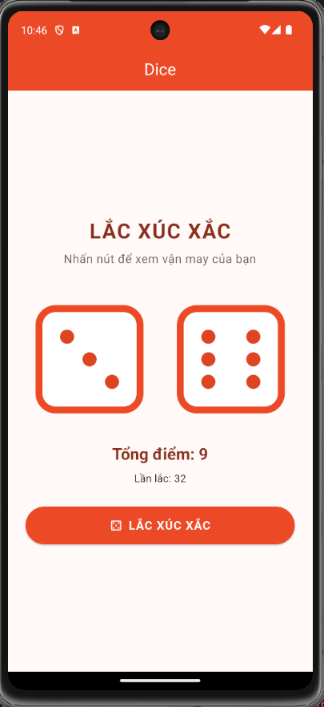

# Lab 3 - Dice

Ứng dụng Flutter mô phỏng việc lắc hai viên xúc xắc. Mỗi lần nhấn **LẮC XÚC XẮC**, ứng dụng dùng `dart:math` tạo hai số ngẫu nhiên từ 1 đến 6, cập nhật hình ảnh tương ứng và hiển thị tổng điểm.

## Ảnh chụp ứng dụng



## Nội dung bài lab

- Giao diện Material Design với `MaterialApp`, `Scaffold`, `AppBar`, `Column`, `Image.asset` và `ElevatedButton`.
- Quản lý hai giá trị xúc xắc bằng `StatefulWidget` và `setState()`.
- Sáu ảnh mặt xúc xắc nằm trong `assets/` và được khai báo trong `pubspec.yaml`.
- Có widget test kiểm tra màn hình và thao tác lắc.

## Chạy ứng dụng

```bash
flutter pub get
flutter run
```

## Kiểm tra

```bash
flutter analyze
flutter test
```

Các PNG được tạo bằng [`tools/generate_dice_assets.py`](tools/generate_dice_assets.py); script này cần Pillow nếu muốn tạo lại ảnh.
